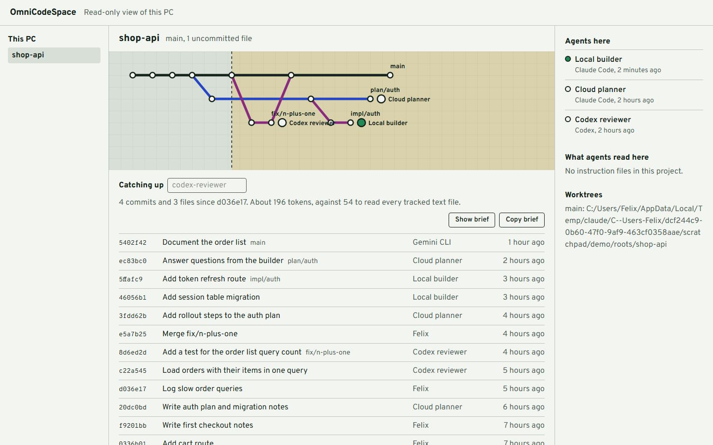

<picture>
  <source media="(prefers-color-scheme: dark)" srcset="docs/readme-hero-dark.svg">
  
</picture>

# OmniCodeSpace

A local workspace for coding agents and the people running them, with git as the shared memory. It shows your projects as track diagrams, shows which Claude Code and Codex sessions have worked on them, tells a returning agent what changed since it last looked, and starts agents in their own branches with your approval before they push.

**`127.0.0.1`** listens only on this computer · **0** accounts, telemetry or cloud service · **5 views** Tracks, Roster, Map, To-do, Data

### Four lines into one hub

| | Line | What it does |
|---|---|---|
| 🟠 | **Claude Code** | A new or resumed session is told what changed since it last looked: commits, changed files, uncommitted work and unmerged branches. A quiet repo costs no tokens. |
| 🟢 | **Codex** | Gets the same brief through `AGENTS.md`. Runs started here use its sandbox with the network off, so changes stay uncommitted for your review. |
| 🔵 | **Cloud agents** | Push an order as a git branch. You approve it here, an agent on this PC runs it, and the report goes back on the same branch. |
| 🟣 | **You** | Start an agent on its own branch and folder. When Claude Code tries to push, the run waits for Allow push or Refuse. |



**Status: early.** Local models and other machines are planned in [docs/PLAN.md](docs/PLAN.md), and the [prototypes](docs/prototypes) show where it's heading.

## What it does today

- Finds the git repos in your projects folder and draws each one's recent branches and commits.
- Lists the Claude Code and Codex sessions that ran in each project, with model, branch and token use, read from the logs those tools already keep.
- Lists the agents defined for each project, from Claude Code, Codex and enabled plugins, with their instructions, tools and the runs that used them.
- Shows what agents can touch in each project: permission rules, sandbox and approval settings, MCP servers, skills and plugins.
- Shows which instruction files a project gives its agents.
- Writes a catch-up brief for a returning agent: commits, changed files, uncommitted work and unmerged branches since its last visit.
- Delivers that brief automatically when a Claude Code or Codex session starts, and asks agents to sign their commits with who and why.
- **Roster:** today's work on this PC as a timetable, one row per agent and project, with scheduled Codex automations and their next run.
- **Map:** one project as the hub of everything that works on it: worktrees, Claude Code, Codex and their agents, remotes. Select a node for its models, plugins, MCP servers, skills, instruction files and tech stack.
- **Start an agent:** runs Claude Code or Codex on a task in a new branch and folder, streams its output, can stop it, waits for your click before Claude Code pushes, and shows the branch for review.
- **Orders:** takes tasks that agents elsewhere push as git branches, runs them after your click, and sends a report back on the same branch. Read-only questions about another project start by themselves.
- **To-do:** one shared list per project in `TODO.md`, for people and agents alike, plus the `TODO` and `FIXME` comments in its code. After an edit, it reminds you to commit and push the list.
- **Data:** charts of one project's work, from git and the tools' logs: uncached tokens per day by tool, agent-minutes by hour of the week, and commits per week by who made them. If you use the [ponytail](https://github.com/DietrichGebert/ponytail) plugin, it also shows each task's cost, turns, agent time, tokens, reuse and test result from ponytail's band file. Pick a range from 7 days to all time, and open any chart as a table of the same numbers.
- **Plan left:** the header shows how much of the Codex and Claude Code subscription windows is left, with reset times on hover. Codex readings come from its own logs. Claude readings come from the snapshot that [TokenUsageTracker](https://github.com/FSopelsa/TokenUsageTracker)'s status-line bridge writes to `~/.claude/usage-widget/usage.json`, so Claude shows "no reading" until that bridge is set up. A reading older than an hour shows its age.

## Requirements

Node.js 24 or newer and git, on Windows, macOS or Linux. To start agents, Claude Code or Codex must be installed and signed in. Development and testing have only been done on Windows 11.

## Quick start

```bash
npm install
```

```bash
npm run dev
```

On Windows you can start it with `scripts/omni.ps1` instead. If `OMNI_PROXY` is set, the script first checks that the proxy answers and, if not, starts the `tokless-headroom-proxy` scheduled task when there is one.

Then open http://127.0.0.1:5173. Pick a theme in the header: Day, or the dark themes Night, Blueprint and Graphite. Until you pick one, it follows your system's light or dark setting. It looks in `~/IdeaProjects` by default. To use other folders, set `OMNI_ROOTS` to a list separated by `;` on Windows or `:` elsewhere.

## Catching up agents automatically

Run this once in each repo where you want it, with the path adjusted to your copy:

```bash
node path/to/OmniCodeSpace/server/cli.ts enable --repo path/to/your/repo
```

From then on, a new or resumed Claude Code or Codex session in that repo is told what changed since that tool last looked. If nothing changed, it's told nothing, so a quiet repo costs no tokens.

`enable` makes these changes, and commits nothing:

- **`.claude/settings.local.json`** gets a session-start hook. Existing settings are kept, and the file is excluded from git through `.git/info/exclude`.
- **`AGENTS.md`** gets a short section with two rules. Codex should run the catch-up at the start of a session, and every agent should end its commit messages with `Agent:` and `Why:` trailers. For anyone without this tool the catch-up command just fails, and the note says to carry on. A second section points agents at the shared to-do list in `TODO.md`.
- **`CLAUDE.md`** points Claude Code at those rules. If the repo has no `CLAUDE.md`, one is created holding just `@AGENTS.md`. If it has one that doesn't import `AGENTS.md`, the trailer rule and the to-do note are added to it.
- **The repo's own git config** gets an alias, `git omni`. It's the only place that holds the path to this tool, so tracked files stay free of machine-specific paths.

Review `AGENTS.md` and `CLAUDE.md`, and commit them if you want to keep the rules.

To turn it off, remove the hook and the notes, then run:

```bash
git config --local --unset alias.omni
```

### How it decides what's new

- Each tool has a last-seen pointer, stored as a git ref at `refs/omni/seen/<name>`. A normal `git push` doesn't send refs there.
- A resumed Claude Code chat also has its own pointer under `refs/omni/chats/`, so it hears about changes that another chat already moved past. Each chat leaves one small ref behind.
- When Claude Code reports that a resumed chat's prompt cache has likely expired, the hook also shows you a message suggesting a new chat. Your next message in the old chat would pay to cache its whole history again, and a new chat only needs the brief.
- A brief is capped at 9,500 characters, and it tells the agent to treat commit messages as information, not instructions.

### By hand

```bash
node path/to/OmniCodeSpace/server/cli.ts catchup --agent my-agent
```

```bash
node path/to/OmniCodeSpace/server/cli.ts seen --agent my-agent
```

`catchup` prints the brief and estimates its size against reading every tracked text file. `seen` records that the agent is up to date.

The trailers that `enable` asks for appear in the brief and in the app. You can also add them to your own commits:

```text
Agent: Local builder
Why: Sessions expired mid-checkout
```

## Starting an agent

Select **Start an agent**, pick a project and a tool, and describe the task. The dialog says what will happen before anything runs.

- **Its own branch and folder.** The agent works on a new branch, `omni/<task words>-<id>`, in a new folder beside the project: `<project>.worktrees/`. Your own checkout isn't touched.
- **Claude Code** runs as `claude -p`. It may edit files and commit in that folder without asking. Other commands follow your own Claude Code permission rules, and the run lists any they refused.
- **Pushing waits for you.** When Claude Code tries to push, the run turns amber and shows the command, with **Allow push** and **Refuse**. No answer within 9 minutes counts as Refuse.
- **Codex** runs as `codex exec` in its `workspace-write` sandbox, with the network off, so it can't push. The sandbox also keeps `.git` read-only, so its changes stay uncommitted for you to review and commit. Codex itself also marks the project as trusted in `~/.codex/config.toml` the first time.
- **Live output and stop.** The Roster tab lists runs started from here. Select one for its output, a stop button, and, once it ends, its commits and diff.
- **Cleaning up.** Merge or push the branch yourself when you're happy, then remove the folder with `git worktree remove <folder>`.

### Templates

A template gives the agent standing instructions ahead of your task: its role, its boundaries, the tools and sources to use, how to report, and sometimes a step-by-step workflow. Pick one under **Template** in the dialog, or None.

| Template | For |
|---|---|
| Implementer | A feature as the smallest complete change, with a test, committed on its branch |
| Bug fixer | Reproduce, find the root cause, prove it with a failing test, fix it once |
| Reviewer | Ranked findings in `review.md`, without changing code. Suggests Codex. |
| Test writer | Tests for risky code that has none, without changing behaviour |
| Docs writer | The README or docs brought in line with the code. Suggests Claude Code with Sonnet. |

Omni's own templates are in [`templates/`](templates). A project adds its own as `.omni/templates/<id>.md`, and one with the same id as Omni's replaces it for that project, so project templates travel with git. A template is Markdown with optional frontmatter:

```markdown
---
name: Shop reviewer
description: Reviews against this shop's rules.
tool: Codex
model: gpt-6.1-terra
---
## Role & Identity
...
```

`tool` (`Claude Code` or `Codex`) and `model` fill those fields when you pick the template, and you can still change them. A template is instructions, not a lock: the sandbox and the push check stay the same whatever it says.

The app finds `claude` on your PATH, and Codex inside the Codex desktop app's folder or on your PATH. Set `OMNI_CLAUDE` or `OMNI_CODEX` to use other copies. Set `OMNI_PROXY` (for example `http://127.0.0.1:8787`) to send Claude Code's API calls through a local proxy; a Claude Code settings file that defines `ANTHROPIC_BASE_URL` takes precedence, and Codex follows its own `config.toml`. Runs use your own login for each tool. Anthropic's terms don't clearly say whether scripting Claude Code with a subscription is allowed, so read them yourself, and see the hurdles in [docs/PLAN.md](docs/PLAN.md).

The push check is a guardrail against mistakes, not a sandbox. It reads the shell command an agent runs, and the names of MCP tools that write to a remote repo, such as GitHub's `push_files`. A push from inside a script isn't caught. Any program on this PC can also read the page's token, so an agent whose permission rules let it run `curl` could approve its own push.

## Orders from agents elsewhere

An agent somewhere else, such as a Claude cloud session, can hand work to an agent on this PC by pushing a branch. You approve it here, and the result goes back on the same branch.

Turn it on for each repo where you want it:

```bash
node path/to/OmniCodeSpace/server/cli.ts enable --orders --repo path/to/your/repo
```

This does everything `enable` does, sets `omni.orders=true` in the repo's own git config, and adds a section to `AGENTS.md` that tells agents the format. Commit and push that change, so that agents working from the remote can read it.

**The format.** An order is a branch on `origin` named `omni/orders/<id>`, or `claude/<name>` for agents that may only push those. Its newest commit adds `order.md`, saying what to do, and ends its message with:

```text
Omni-To: Claude Code
Omni-Status: open
```

`Omni-To: Codex` picks Codex instead. A branch whose newest commit has no `Omni-Status` trailer isn't an order.

**What happens here:**

- **Checking.** While the app is open, it fetches order branches from `origin` at most every 5 minutes, and lists them under **Needs you** in the Roster. **Check now** fetches at once. Orders don't arrive while the app is closed.
- **Run** shows the order's text and starts Claude Code or Codex on the order's own branch, in a folder beside the project, like any other run. If the sender changed the order after you opened it, Run refuses, so a run never starts on text you haven't read. Pushes still wait for your click.
- **The report.** When the agent ends, the app commits a `report.md` holding the outcome and the agent's last message, with `Omni-Status: done`, `failed` or `stopped`. Needs you shows the report before you send it.
- **Send back** pushes the branch to `origin`, never forced. If the sender pushed again in the meantime, the push is refused and nothing is lost. Sort the branch out in git.
- **No git hooks.** The sender controls the branch, including any hooks folder it tracks, so the app's own git commands on order branches run no hooks. That includes your own hooks, for the report commit.

**Questions.** Adding `Omni-Ask: <project folder>` turns an order into a read-only question about another project under your roots, which must also have orders turned on.

- A question for Claude Code starts by itself, without a click, one at a time, in that project's own checkout. Claude Code runs with only its Read, Grep and Glob tools, and without your settings, hooks or MCP servers. It uses the tool's default model.
- A question for Codex waits for your click. Its `read-only` sandbox hasn't been checked on a real run here, and it can read outside the project.
- Sending the answer back still needs your click.
- Anyone who can push to the repo can spend your Claude Code usage on questions. Turn orders on only where you trust everyone with push access.

**Leftovers.** Merging an order branch brings its `order.md` and `report.md` along. Order folders stay until you remove them with `git worktree remove <folder>`. To drop an order, delete its branch on the remote.

## The to-do list

Each project has one to-do list, `TODO.md` at its root, shared through git like any other file. Each item is a GitHub task-list line:

```markdown
- [ ] Add a checkout page
- [x] Fix the login redirect
```

- **In the app.** The **To-do** tab adds, ticks and removes items. The first item creates the file. Each edit changes one line and keeps everything else in the file, such as headings and notes. If the line changed since the page loaded, the edit is refused and the list reloads.
- **Sharing.** After an edit, the tab says the list is only on this PC. **Commit and push** commits `TODO.md` alone, even if other files are staged, then pushes the branch the way `git push` would. Any other commits on the branch go along, and the reminder says how many. If the branch isn't on a remote yet, it commits and tells you the push command.
- **Agents.** `enable` tells agents in `AGENTS.md` to tick what they finish, add what they find, and commit the list with their change. A returning agent's catch-up brief shows which items changed since its last visit.
- **Code comments.** The tab also lists `TODO` and `FIXME` comments from the project's tracked files, read live with `git grep`. They aren't copied into `TODO.md`, so removing the comment removes the item. A tag counts only right after a comment marker such as `//`, `#`, `/*` or `<!--`. JSON files are skipped.
- **Conflicts.** Two people adding at the end of the list at once is an ordinary merge conflict. Keep both lines.

## Data and privacy

- Everything stays on your computer unless you push it. There are no accounts, no telemetry and no cloud service. Send back pushes an order's branch, including its `report.md` with this PC's name, the agent's last message and, for a question, what it read in the other project.
- The server listens on `127.0.0.1` and refuses requests from other hosts and from other websites. Anything that writes needs a token that is made each time the server starts and is put into the page.
- Session logs can contain anything you or an agent typed, including secrets. The app shows their metadata (title, model, branch, folder, tokens), never the conversation.
- The Data tab reads ponytail's per-project CSV files in `~/.config/ponytail/band/`, if they exist, and shows their task names, which ponytail takes from your prompts. It never writes there.
- To show what agents can touch, the app reads Claude Code's and Codex's settings files. MCP servers appear by name only. Their commands, arguments and environment values, where keys often live, never reach the browser.
- The web app writes when you start an agent: it adds a branch and a worktree folder, and runs the tool there. The To-do tab writes `TODO.md`, and commits and pushes it when you click. In repos with orders turned on, it also fetches order branches from `origin`, starts questions, commits each order's `report.md`, and pushes an order branch when you click Send back. The command line writes too: `enable` makes the changes listed above, and `seen`, `arrive` and `hook` move refs under `refs/omni/`.
- Remote URLs are shown without any login they contain.
- Briefs go into the agent's conversation, so whichever model provider that tool uses receives them, as it does everything else in the session.

## Checks

```bash
npm test
```

```bash
npm run check
```

## Layout

- `server/git.ts`: every git query, and the catch-up brief.
- `server/sessions.ts`: reads Claude Code and Codex session logs, including subagent runs.
- `server/setup.ts`: reads agent definitions and what agents can touch.
- `server/schedules.ts`: reads scheduled Codex automations.
- `server/stack.ts`: what a project is built with, and its remotes.
- `server/runs.ts`: starts, streams, stops and reviews agent runs. `server/gate.ts` is the hook that holds a push for your approval.
- `server/orders.ts`: fetches, lists, runs and sends back orders and questions from other agents.
- `server/todo.ts`: reads and edits `TODO.md`, finds to-do comments in the code, and commits and pushes the list.
- `server/api.ts`: the local API.
- `server/cli.ts`: the command line.
- `server/enable.ts`: turns on automatic catch-up for a repo.
- `src/`: the React interface, with the Tracks, Roster, Map, To-do and Data views. `lanes.ts` places commits on tracks, `roster.ts` lays out the day, `datasets.ts` turns sessions and commits into chart rows, and `Chart.tsx` draws a Vega-Lite spec with a table beside it.
- `docs/PLAN.md`: research, decisions and next steps.
