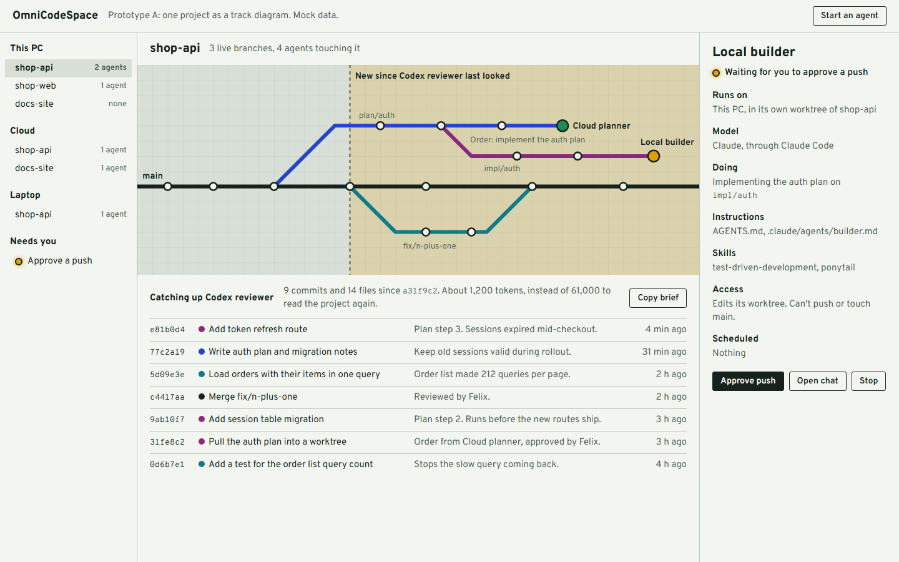
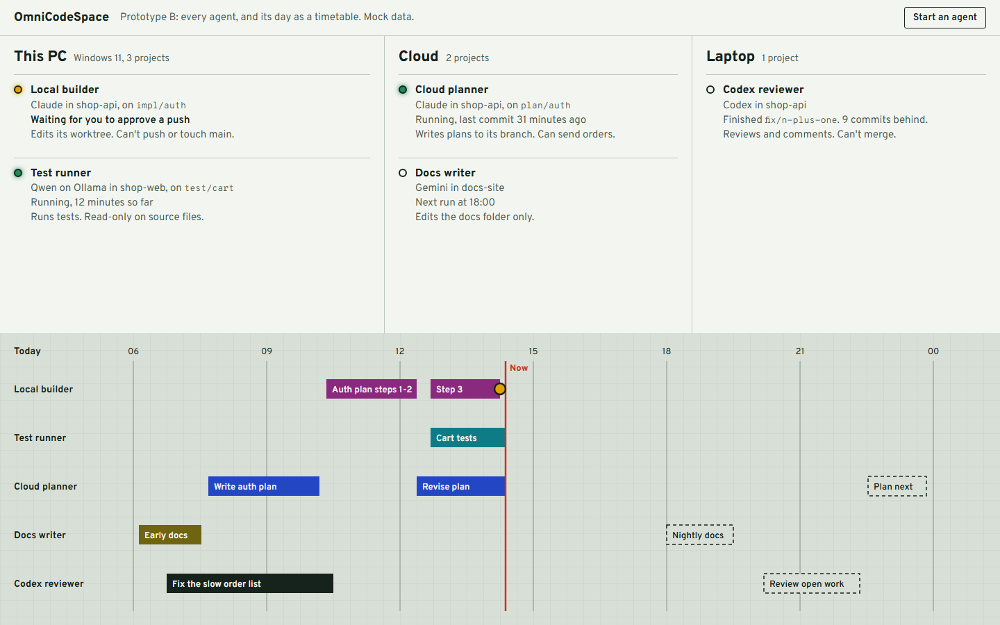
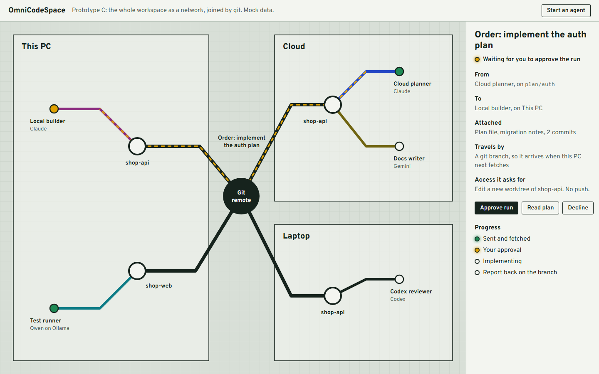
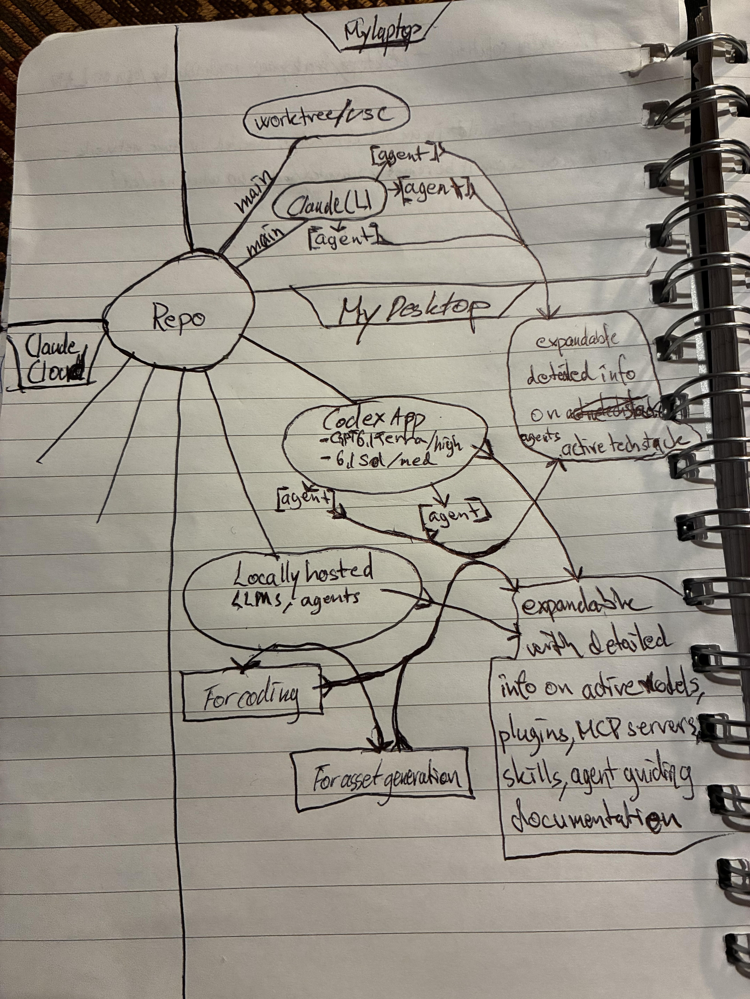

# OmniCodeSpace plan

A workspace for agents and the people controlling them: browse environments, projects and agents, see their scopes, what they're doing and have done, and let agents from different LLMs pass work to each other.

**Short version:** build on git, don't build a new format, and don't compete with the tools that already manage providers and configs. The missing piece is small: a view across everything, a record of who has seen what, and a safe way to hand over work.

Status of the claims here: "measured" means I ran it on real repos on this PC. "Reported" means it comes from web sources I read but didn't test. Decisions marked "my call" are yours to overrule.

## Is this basically git?

Mostly, yes, and that's the best thing about the idea. Your instinct is right for the things that are about the code. Git has no answer for the things that are about the agents.

| You want | Git already does it? | What's left to add |
|---|---|---|
| Same picture of a project for every agent | Yes, a commit SHA is exactly that | Nothing |
| See what changed since some point | Yes, `git log` and `git diff` | Nothing |
| Isolate parallel agents | Yes, worktrees | Starting and cleaning them up |
| Move work between machines and cloud | Yes, branches and remotes | A convention for "this branch is an order" |
| Remember why a change was made | Partly, commit messages and trailers | Getting agents to write them |
| Know what each agent last saw | No, but a ref can hold it | `refs/omni/seen/<agent>`, built |
| Know who's running right now, and where | No | Read tool logs, built for this PC |
| Instructions, skills, permissions, schedules | No, it just stores the files | Read and display them |
| Approvals before an agent acts | No | The app's job |
| Different LLMs talking live | No | Doesn't need to be live, see step 11 |

So the description "a git visualization tool connected to an agent admin tool" holds. One nuance: git is where agents leave results, not how you control a running one. Stopping an agent, or seeing that it's waiting for you, has to go through the tool running it.

## Do we need a new context format?

No. I'd skip it, for three reasons.

**Every LLM already reads markdown and git output well.** A new format would need teaching, and that teaching costs tokens in every prompt.

**Long context files can backfire.** A study of `AGENTS.md`-style files found they didn't generally raise task success and raised cost by over 20%. Project overviews weren't useful, and hand-written files beat generated ones ([arXiv 2602.11988](https://arxiv.org/pdf/2602.11988)). Later work reports mixed results, some with efficiency gains ([arXiv 2607.27250](https://arxiv.org/pdf/2607.27250)), and these benchmarks don't cover multi-repo or long-running work. So a generated "project image" that every agent loads at every start is the design to avoid.

**Your "image" idea works without one.** The image is a commit SHA. Comparing it with now is a `git diff`. All that was missing is a pointer per agent, plus a short brief assembled only when an agent returns. That's what `omni catchup` does.

### How big a brief is (measured)

I ran `catchup` on local clones of 11 of your repos, pretending the agent last looked 5 commits ago. Your real repos were not changed.

| Project size (tokens, all tracked text) | Brief | Raw diff of those 5 commits |
|---|---|---|
| 123,594 | 1,529 | 102,644 |
| 60,637 | 652 | 23,968 |
| 48,960 | 924 | 19,308 |
| 45,390 | 632 | 45,183 |
| 42,705 | 405 | 23,353 |
| 24,340 | 644 | 19,926 |
| 24,109 | 353 | 29,607 |
| 23,990 | 484 | 45,625 |
| 23,985 | 505 | 8,483 |
| 14,459 | 1,011 | 22,502 |
| 6,476 | 233 | 4,364 |

- The brief was 0.9% to 7% of the project, with a median of 1.9%.
- **Raw diffs aren't the cheap option you'd expect.** In 3 of 11 repos the diff of just 5 commits was bigger than the whole project. So the brief lists files and leaves diffs to be fetched when needed.
- On a tiny project the brief can cost more than reading everything (196 against 54 in the demo repo).

**What this doesn't prove.** Tokens are estimated at 4 characters each. A brief says what changed, not how the code works, and an agent will still open files. A real agent also wouldn't read every file. So these are bounds, not savings. Step 2 measured real sessions: the brief made agents right about what was new, but didn't make them cheaper.

### Two other findings on token spend

- **Resuming an old chat can be the expensive path.** In one real session in your logs, cached re-reading came to 20.5 million tokens, against 1.1 million new input and 70,000 output. Long chats keep paying for their own history, and prompt caches expire. Step 2b measured this. After a break, a fresh chat plus a brief cost about a third as much as resuming, and was equally right.
- **A different LLM can't use another's transcript anyway.** Text in the repo is the only memory they all share.

## How the pieces relate

This answers your earlier question about chats versus projects versus agents. They're different layers, and only one is really "the agent".

| Thing | What it is | Lives in |
|---|---|---|
| Place | Where work runs: this PC, a laptop, a cloud environment | The machine or service |
| Project copy | A repo or worktree in a place | Git |
| Agent | A lasting definition: name, instructions, skills, access, model | A file, such as `.claude/agents/builder.md` |
| Run | One chat or session, working as an agent, in a project copy | The tool's own logs |
| Order | A request from one agent to another | A git branch |

Treating a chat as an agent is what makes this confusing today: chats end and lose context, while an agent should outlast any one chat. When you describe the product, say "workspace for agents". A chat is just one run of an agent.

## What already exists

| Project | What it is | Relation to this |
|---|---|---|
| [CC Switch](https://ccswitch.io/en/) | Very popular MIT desktop app (Tauri 2, Rust, React, SQLite). Switches providers, syncs MCP, skills and prompts, shows sessions and usage, for 12 to 13 tools | **Complement, don't compete.** It answers "how is each tool set up?". Nothing I read shows it coordinating agents or using git as shared state. Don't rebuild this part |
| [Sugabots](https://github.com/nitrictech/sugabots) | MIT team chat where people and API-backed bots work together. Postgres, Docker, Bun | **Only a partial match.** Good ideas to borrow: pods, threads for bot-to-bot help, per-tool approval, routines. But it doesn't use git as shared state, and nothing I read shows it wrapping CLI agents |
| [Vibe Kanban](https://www.vibekanban.com/docs/getting-started) | Kanban board that runs agents in worktrees | Closest on control. Reportedly Apache-2.0, with the hosted product wound down (one source). Look here before step 7 |
| [Agent Console](https://awesome.ecosyste.ms/projects/github.com%2Fms2sato%2Fagent-console) | MIT browser dashboard for agents in worktrees. Tested on macOS and Claude Code | Similar start, small enough to read |
| [Swarm](https://hn.jakechampion.name/reader/https://github.com/penberg/swarm), [wt-tools](https://awesome.ecosyste.ms/projects/github.com%2Ftatargabor%2Fwt-tools) | Worktree managers with GUIs | Swarm is Linux-only. Good worktree reference |
| [Entire](https://github.com/entireio/cli) | MIT CLI that saves agent transcripts per commit under `refs/entire/checkpoints/` with a commit trailer | **Very close to your idea.** Reuse rather than build capture. Note it pushes transcripts to your remote |
| [Agent Trace](https://github.com/cursor/agent-trace) | Draft spec for marking which code came from AI | Follow it if attribution matters. Still an early RFC |
| [Beads](https://github.com/steveyegge/beads) | MIT task graph for agents, on Dolt, synced through git | Use if you want a shared task queue. Adds a database |
| [Agent Client Protocol](https://agentclientprotocol.com/) | Standard for clients to drive coding agents, JSON-RPC over stdio. Adapters exist for Claude and Codex | **The way to connect many LLMs properly**, see step 13. TypeScript SDK: `@agentclientprotocol/sdk`. Licence not checked |

**Claude's own features.** [Remote Control](https://code.claude.com/docs/en/remote-control) is a window from your phone or browser into a session on your machine, so it's you controlling one session, not agents ordering each other. [Agent teams](https://code.claude.com/docs/en/agent-teams) let Claude sessions message each other through local files, but they're experimental and Claude-only. Cross-session messaging exists too, and the tool notes in this app say cloud sessions can receive messages but can't send any back yet. That is the gap git fills in step 11.

## GUI alternatives

All three share one look: an enamel signal-box panel, where tracks are branches and lamps show where agents are. Plain words stay in the interface, so it's still agents and branches, not trains.

### A. Tracks: one project in depth (recommended, and what's built)



Best for your main question: what's happening in this repo, and what's new since I looked? The shaded area is your "image" idea made visible.

### B. Roster: agents and their day



Best for "what are they all doing, and what's scheduled?". Built at step 6 as the second tab. Agents started from the app appear here too, with their live output.

### C. Map: the whole workspace



Best for explaining the system and following an order across machines. It shows git as the thing joining everything.

**Built as the third tab, one project at a time**, after your sketch below. The project is the hub. Around it are three places: this PC, with its worktrees, Claude Code, Codex and local models; the cloud, reached through the project's remotes; and other machines. Agents hang off the tool that runs them, and select any node for its details: models used here (with Codex's effort), agents, plugins, MCP servers, skills, instruction files and what the project is built with. Local models and other machines are dimmed placeholders until steps 10 and 14. Showing one project keeps it readable, so the whole-workspace version waits until orders (step 11) give it something to follow.



## Architecture

```text
 Browser UI (React)
      |  HTTP on 127.0.0.1, writes need a token made per launch
 Local server (Node)
      |-- git CLI ............ repos, branches, worktrees, refs/omni/*
      |-- tool logs .......... ~/.claude/projects, ~/.codex/sessions
      |-- instruction files .. AGENTS.md, .claude/agents, .mcp.json
      '-- agent runs ........ claude -p / codex exec in worktrees, push gate

 Other machines and cloud sessions connect only through the git remote.
```

There's no database and no service of our own. Git and the tools' logs are the storage, which is why this stays cheap and works offline.

## Tech stack (my call)

| Part | Choice | Why |
|---|---|---|
| Language | TypeScript throughout | You know it, and the agent SDKs and ACP are TypeScript |
| Server | Node 24, built-in modules | Runs `.ts` directly, with no framework needed yet |
| UI | React, Vite, Tailwind | Your stack |
| Git access | The `git` command | Complete and exact. Libraries only cover part of it |
| Commit graph | About 30 lines of own code | Small, tested, and packages didn't clearly fit |
| Storage | None yet, then `node:sqlite` if needed | Built into Node, no dependency |
| Charts | Vega-Lite, loaded with the Data tab | Specs are JSON, so any agent can write one without running code. See "Data and charts" |
| Live updates | Polling every 5 seconds, then SSE | Enough until agents stream output |
| Starting agents | Each tool's own CLI first, ACP later | Same tools you already use |
| Remote access | Tailscale, if ever | Avoids building login and security |
| Packaging | None yet, see decision 4 | A browser tab is enough for now |

## Steps

Each step ends in something you can check. Stop whenever it's useful enough.

### Done

**Step 0: read-only view and catch-up.** Works on your real repos.

**Step 1: automatic catch-up.** `omni enable` turns it on per repo, with 29 passing tests in total. *Checked with real sessions on temp repos, verified:*

- **Claude Code:** I resumed a chat after someone else's commit. With hooks off, it answered "I don't know". With the hook on, it named the commit, the agent and the reason, none of which it had been told.
- **Codex:** a new session given a neutral prompt ran the command by itself, in its normal sandbox, and reported the change and the reason.

Three things differ from the original sketch of this step:

- A repo-local git alias holds the path to the tool, so `AGENTS.md` stays safe to commit.
- A resumed Claude chat keeps its own pointer. Without one, a second chat moving the shared pointer would leave the first chat wrongly told that nothing had changed.
- **Codex hooks are real but not used yet.** Codex has `SessionStart` hooks in `.codex/hooks.json`, which would be neater. In one `codex exec` test the hook didn't fire, even with the project trusted for that run and the hook-trust check bypassed, and I didn't find out why. A second run with the bypass was refused by the safety check, so I left it. They need trusting through `/hooks` in Codex, so that's worth trying by hand before replacing the `AGENTS.md` note.

The Codex route only asks the agent to run the command, so unlike the Claude hook, it can't guarantee it happens.

**Step 2: real savings, measured.** The brief makes agents right about what's new, but it doesn't make them cheaper.

**Setup.** I ran 20 new Claude Code sessions (Sonnet, `claude -p`) on throwaway clones of two of your repos:

- **Workshop E-commerce Platform JPA:** last seen at the 29 Sep commit, with 6 new commits after it, 3 of them merges.
- **Poklone:** last seen before the August gap, with 5 new commits after it.

Each clone had a stand-in remote, so it looked up to date. Every session got the same prompt: new commits have landed since you last worked here, get up to speed, and give a handover covering what changed, why, and what looks risky. The hook ran in both arms. In the "without" arm it had nothing to say. Personal plugins were off, the tools were read-only, and the arms alternated so prompt caching favoured neither. I scored the answers against a rubric written before reading them, with the arms hidden. Brief answers name their starting commit, though, so the hiding only partly worked.

| Median of 5 runs | JPA, without | JPA, with brief | Poklone, without | Poklone, with brief |
|---|---|---|---|---|
| Cost per run at list price | $0.064 | $0.070 (+9%) | $0.078 | $0.073 (−6%) |
| All tokens processed | 151,030 | 80,183 (−47%) | 151,879 | 80,526 (−47%) |
| Uncached tokens (input, cache writes, output) | 10,470 | 13,342 (+27%) | 12,987 | 13,930 (+7%) |
| Turns | 4 | 3 | 4 | 4 |
| Seconds | 21 | 20 | 24 | 20 |
| **Knew what was new (of 5)** | **0** (3 said nothing new, 2 couldn't tell) | **5** | **0** (3 guessed the right start and said so, 2 said nothing new) | **5** |
| New commits described, average of 5 | 3.8 | 4.6 | 4.8 | 4.8 |
| Factual errors, total over 5 runs | 3 | 3 | 1 | 1 |

- **Tokens fell by half, but cost didn't.** The tokens the brief saves are cheap cached re-reads of the session's fixed context. The tokens it adds are the brief itself plus the diffs the agent still opens, and those are full price. With no brief, an agent simply runs `git log` and `git show`, which is cheap.
- **The real difference is correctness.** Without the brief, an agent has no way to know where it left off. Most reported "nothing new" while describing the very commits it was asked about. With the brief, every run named the right range.
- **Depth didn't change.** In JPA, an unmentioned starter swap in "Fixed some warnings" was the best finding. It was caught in 1 run with the brief and 2 without. Cost with the brief also varied less ($0.07–0.08 against $0.05–0.12 on Poklone).

**Verdict against the cost bar (1%, see below).** By cost, the brief is +9% in JPA and −6% in Poklone, both inside the run-to-run spread, so it doesn't clearly pass. The work didn't get worse, though: the "what's new" part went from wrong or unknown to right. **Decided: keep the brief**, as a correctness feature, and don't claim it saves tokens yet.

**The cost bar: 1%.** A brief or format counts as cheaper when its median cost per run, at list price, is at least 1% below going without, on the same clones and prompt. The bar was 30% at first and was lowered to 1% on 2026-11-03, because at this stage all data is valuable to us: the research runs alongside building Omni, and even small savings on small repos, with nothing tuned yet, show which way to go. A result inside the run-to-run spread is still reported as such.

Historical stats, from when the bar was briefly 5%:

| Test | Result |
|---|---|
| Haiku | Passes in both repos (−14% to −17%) |
| Sonnet, step 2 | Fails: +9% in JPA, −6% in Poklone |
| Pointer + extracts | −7% in JPA, −3% in Poklone |

The Sonnet and pointer + extracts differences are all inside the run-to-run spread, so none of them clearly passes.

**Use this format for new tests.** Once the 1% bar has been made known after the rebuild, report each new test against it as a table like the one above (test, result per repo), followed by one line on which results sit inside the run-to-run spread.

**Limits of this test:**

- One model, one tool and one kind of prompt, with 5 runs per cell.
- Each clone had a fresh reflog, which made it obvious no earlier session existed. A real repo's reflog might lead an agent to a better guess.
- With personal plugins on, fixed overhead grows, and percentages shrink further.
- If you tell the agent the range yourself, the correctness gap mostly goes away.
- Resuming an old chat against starting a fresh one is tested in step 2b, below.
- The runs went straight to Anthropic, not through a local proxy. The list price of all 22 runs, including the pilot, was about $1.70.

**Step 2b: Codex, Haiku, and resume against fresh, measured.** The same setup, clones and prompt as step 2, with 5 runs per cell and the arms alternating. The extra runs found the same thing. The brief makes every agent right about what's new, but cheaper only by Haiku's 14–17%. Once a chat's cache has expired, a fresh chat with the brief beats resuming.

| Median of 5 runs | JPA, without | JPA, with brief | Poklone, without | Poklone, with brief |
|---|---|---|---|---|
| **Haiku:** cost per run at list price | $0.007 | $0.006 (−17%) | $0.008 | $0.007 (−14%) |
| Haiku: all tokens processed | 200,977 | 129,136 (−36%) | 258,350 | 180,478 (−30%) |
| Haiku: uncached tokens | 17,909 | 17,569 (−2%) | 23,968 | 22,423 (−6%) |
| Haiku: turns | 8 | 4 | 6 | 5 |
| **Haiku: knew what was new (of 5)** | **0** (2 guessed right and said so, 3 couldn't tell) | **5** | **0** (all 5 guessed right and said so, 2 miscounted) | **5** |
| **Codex:** all tokens | 123,881 | 117,168 (−5%) | 129,166 | 147,494 (+14%) |
| Codex: uncached tokens (input not from cache, plus output) | 15,480 | 22,793 (+47%) | 11,252 | 25,423 (+126%) |
| Codex: commands run | 11 | 9 | 14 | 9 |
| Codex: ran the catch-up by itself (of 5) | 5 | 5 | 5 | 5 |
| **Codex: knew what was new (of 5)** | **0** (couldn't establish a start) | **5** | **0** (couldn't, and mixed in older work) | **5** |

| Median of 5 runs, Sonnet, both with the brief | JPA, new chat | JPA, resumed chat | Poklone, new chat | Poklone, resumed chat |
|---|---|---|---|---|
| Cost per run, cache still warm | $0.062 | $0.060 (−4%) | $0.094 | $0.086 (−8%) |
| Claude Code's estimate to rewrite the old chat's cache once it has expired | | +$0.17 (42,018 tokens) | | +$0.18 (44,665 tokens) |
| Cost per run, cache expired (estimate) | $0.062 | about $0.23, 3.7× | $0.094 | about $0.27, 2.8× |
| Knew what was new (of 5) | 5 | 5 | 5 | 5 |

- **Haiku:** the brief halved turns in JPA and saved 14–17% of cost, which clears the 1% bar. Without it, Haiku guessed the starting point at best.
- **Codex runs the catch-up reliably.** It ran the command by itself in all 20 runs, because of the `AGENTS.md` note. It never established the range without the brief. With the brief, it ran fewer commands but read more full-price text, mostly diffs inside the range it now knew. So for Codex the brief costs more, and buys correctness.
- **Resume against fresh:** with a warm cache, they cost the same and were equally right. Claude Code flagged no expired cache in any of the 10 resumes, because each came within minutes of the old chat. Once the cache expires, after an hour at most, rewriting even this small 42k-token history makes resuming about 3× dearer than a fresh chat with the brief. Long real chats would cost more still. **So start fresh after a break, and resume only within the hour.** The hook now says so at the right moment. When Claude Code reports `prompt_cache_likely_expired` on resume, the hook shows you a message with Claude Code's cost estimate and suggests a new chat. The model still gets the brief. A run with the flag faked showed the brief reaching the model and the message leaving the hook. How the message looks in the interactive app is unchecked, because a real expiry takes up to an hour.

Limits of step 2b:

- **Fixed versions:** the Codex runs used your model (`gpt-6.1-terra`, high effort) without your `config.toml`, so they skipped the Headroom proxy and your hooks. The Claude runs loaded only local settings, so `rtk` and Headroom were off there too.
- **Haiku's refused commands:** 6 of Haiku's commands without the brief, in JPA, were refused by my test's permission list. These were compound `cd "$(…)"` lines, a PowerShell `Set-Location` and a GitHub search. That cost it turns and is why 3 runs couldn't tell what was new.
- **Coverage not compared:** it was counted by commit hashes named, which Codex rarely writes. Claude's counts were equal between arms (4.0 and 5.0 for Haiku, 5.0 for the resume test).
- **Cost accounting:** a resumed run's reported cost includes the old chat's own cost, which I subtracted. Expired-cache costs use Claude Code's own estimate. They weren't measured.
- **Total cost:** about $1.90 at list price for the Claude runs, including the two old chats. Codex used 2.5 million input tokens, 85% from cache, on your ChatGPT plan.

### Prove the idea

1. *(Done, see above.)*
2. *(Done, see above.)* Everything after this still holds, because the view doesn't depend on the brief.

2b. *(Done, see above.)* Codex, Haiku, and resume against fresh. Opus wasn't run.

### Ongoing: briefs that also save tokens

Step 2 showed where the cost really sits. The brief itself is small. What costs is the diffs an agent opens afterwards anyway, and those are read at full price. So the aim here is an agent that is ready to code with as few full-price reads as possible. What changed since is already in git, so the brief should carry only what git can't say or an agent would miss. *Read* below means I opened the source. *Claim* means a figure from a project's own page or a search summary.

**What the evidence says**

- **No confirmed saving anywhere.** I found no test of a git catch-up brief or a handoff skill that shows lower cost. The one handoff measurement is tiny and mixed. [claudetto](https://github.com/xsyetopz/claudetto/wiki/Handoff-Cost) (*read*; 2 runs per arm, Sonnet) had the handoff step cost $0.0067 against $0.0163 for `/compact`, but with the next turn counted it was $0.061 against $0.046, because both follow-ups re-read work the note called done.
- **Orientation context buys little.** The study cited near the top found no general gain and +20% cost, and a 288-run ablation found no measurable change in correctness (*read:* the [abstract of arXiv 2607.27250](https://arxiv.org/abs/2607.27250), not the paper). Claude Code's docs say to keep what the code can't tell you (pitfalls, rationale, non-default conventions) and cut layouts, dependency lists and architecture overviews (*read:* [memory docs](https://code.claude.com/docs/en/memory)).
- **Anthropic's own pattern for fresh sessions is a progress note plus git.** In [Effective harnesses for long-running agents](https://www.anthropic.com/engineering/effective-harnesses-for-long-running-agents) (*read*), each session commits with descriptive messages and writes a summary into a progress file, and the next one starts from that file and the git log instead of guessing. No token figures.
- **Stars didn't track evidence.** JetBrains measured Caveman (117k stars) at 8.5% fewer output tokens against 65% advertised, and rtk (85k) at 7.6% *higher* cost at low effort and no change at high ([Caveman](https://blog.jetbrains.com/ai/2026/07/speak-to-ai-agents-like-cavemen-tosave-tokens/), [rtk](https://blog.jetbrains.com/ai/2026/07/rtk-claude-code-token-); *read*; their own harness, Sonnet 5, SkillsBench).

**Experiments, best-backed first.** Step 2's clones, prompt and 1% cost bar, Sonnet, 5 runs per arm in each repo with the arms rotating, plus the tokens of every diff read after the brief.

| # | Experiment | Why this one |
|---|---|---|
| 1 | **Handover note** added to the brief: a hand-written best note (the upper bound), mattpocock's `handoff` skill, and a custom skill if those two show what to change | Anthropic's progress-note pattern. Claude Code issue [#11455](https://github.com/anthropics/claude-code/issues/11455) asks for it (27 👍, open). mattpocock/skills has 311k stars. claudetto's n=2 is the only measurement, and it is mixed |
| 2 | **Range pointer + extracts:** the brief cut to the named range, the changed lines of dependency files, and `Why:`, `Gotcha:`, `Next:` trailers | Dependency files change in 10–24% of commits in your repos (below). Step 2's starter swap was caught in 1 run with the brief and 2 without. git-prism (5 stars) also puts dependency changes first |
| 3 | **Code index on or off**, outside the brief | CodeGraph (76k stars) and Serena (31k). Claude Code's docs say symbol navigation cuts file reads, but the savings figures are the projects' own. **Not run:** needs a tool installed |
| later | A cheap model writes the summary, fit the brief to the task, learn from the session logs | Weakest backing, no independent saving found. "Brief only when it pays" is built, see step 2b |

#### Results (3 Nov 2026)

**Experiments 1 and 2, measured.** A handover note didn't pay in this test, while pointer + extracts did what the current brief does at no extra cost and found more. Nothing clearly clears the 1% bar, since every difference sits inside the run-to-run spread.

**Setup.** Step 2's two clones, prompt and last-seen commits, with step 2b's flags (Sonnet 5.5, `claude -p`, read-only tools, user settings off, so no rtk or Headroom). 5 runs per arm in each repo, 50 in all, with the arm order rotating each round. A hook printed a fixed text per arm: nothing; today's brief from `catchup`; the brief plus a handover note; or the pointer text. Two notes were made for the state at the last visit. I wrote one by hand from that commit's history and files (the upper bound, and it knows what came later). The other is mattpocock's `handoff` skill, run after a read-only session in a clone that can't see later commits. Diff tokens are the size of what `git show`, `git diff` and `git log -p` returned, at 4 characters a token.

| Median of 5 runs | Without brief | Brief | Brief + hand note | Brief + `handoff` note | Pointer + extracts |
|---|---|---|---|---|---|
| **JPA:** cost per run at list price | $0.067 | $0.068 (+2%) | $0.062 (−6%) | $0.073 (+9%) | $0.062 (−7%) |
| JPA: all tokens processed | 111,500 | 79,676 (−29%) | 78,695 (−29%) | 81,145 (−27%) | 115,365 (+3%) |
| JPA: uncached tokens | 10,434 | 12,839 (+23%) | 11,479 (+10%) | 13,261 (+27%) | 10,548 (+1%) |
| JPA: turns | 3 | 3 | 3 | 3 | 4 |
| JPA: diff tokens read | 0 | 1,080 | 1,277 | 2,302 | 847 |
| JPA: cost range | $0.051–0.070 | $0.055–0.193 | $0.053–0.074 | $0.061–0.085 | $0.049–0.071 |
| **JPA: knew what was new (of 5)** | **0** (2 said nothing new, 3 guessed a start and said so) | **5** | **5** | **5** | **5** |
| JPA: mentioned the starter swap in `pom.xml` (of 5) | 2 | 1 | 0 | 0 | **5** |
| **Poklone:** cost per run at list price | $0.082 | $0.086 (+5%) | $0.092 (+12%) | $0.090 (+10%) | $0.080 (−3%) |
| Poklone: all tokens processed | 153,617 | 122,663 (−20%) | 135,738 (−12%) | 128,586 (−16%) | 158,655 (+3%) |
| Poklone: uncached tokens | 14,246 | 16,471 (+16%) | 17,131 (+20%) | 18,101 (+27%) | 14,548 (+2%) |
| Poklone: turns | 4 | 4 | 5 | 4 | 4 |
| Poklone: diff tokens read | 2,001 | 3,420 | 2,872 | 1,918 | 1,945 |
| Poklone: cost range | $0.072–0.097 | $0.075–0.095 | $0.080–0.112 | $0.089–0.110 | $0.071–0.086 |
| **Poklone: knew what was new (of 5)** | **0** (all 5 said they had no record, then took the latest 5 commits, right by luck) | **5** | **5** | **5** | **5** |
| Poklone: mentioned `pom.xml` changes (of 5) | 2 | 1 | 3 | 2 | **5** |
| Text added at session start (tokens) | 0 | 715 JPA, 944 Poklone | +about 280 | +725 JPA, +910 Poklone | 402 JPA, 378 Poklone |

- **Against the 1% bar:** pointer + extracts is 7% cheaper in JPA and 3% in Poklone, and the hand-written note 6% cheaper in JPA only. All of these sit well inside the run-to-run spread, so none clearly passes. Total tokens fall 12–29% with the brief or a note, as in step 2, but uncached tokens rise 10–27%, and pointer + extracts leaves both about level.
- **Notes didn't help.** The hand-written note, the upper bound, cost the same as the brief or more (−6% JPA, +12% Poklone against no brief). Neither note made answers more right than the brief alone (5 of 5 either way), and neither surfaced the starter swap (0 of 5 in JPA). The skill's note also cost to write ($0.056 JPA, $0.085 Poklone, Sonnet, write step only) and ran 725–910 tokens, against about 280 for the hand-written one. In JPA it came with more diff reading (2,302 tokens against 1,080), which I can't explain from this data. Since the upper bound doesn't beat the brief, I didn't build a custom skill.
- **Pointer + extracts found more at the same cost.** Its text is about 400 tokens, against 715–944 for the brief. All 10 runs named the right range. In JPA, 5 of 5 mentioned the starter change in `pom.xml` (4 saw it flip from `web` to `webmvc` and back), which was step 2's best finding. The brief had it in 1 of 5 and no brief in 2 of 5. In Poklone, 5 of 5 mentioned the `pom.xml` and build-file changes, against 1–3. The agents ran `git log` themselves, which is the one more turn in JPA. The cost difference against the brief (7–9% cheaper) is inside the spread, so I can't claim it.
- **The one expensive run** was the first JPA brief run ($0.193, twice the uncached tokens of the rest). It looks like a cold cache, and I kept it in.
- **Suggested next step:** try the pointer format as the brief on a third repo and on a task that asks for coding, not a handover, before replacing the current brief. I haven't touched `server/git.ts`.

**Limits of these runs:**

- One model, one prompt, 5 runs per cell, two repos. Both repos were run at the same time, the arms in each rotating.
- The prompt asks what changed since the last session. A note written before the new commits can't answer that, and its real job, carrying intent and the next step for continuing unfinished work, isn't exercised. So this does **not** show that notes are useless for coding. It shows they don't make a catch-up cheaper.
- The notes were added to the brief, not used alone. The hand-written one is the best case and I knew what came later. The skill's note also carried your `CLAUDE.md` preferences and a list of first steps to re-verify, which a purpose-built note would leave out.
- I counted "knew what was new" by whether the answer named the last-seen commit and whether it hedged, not by the step 2 rubric, and I did not hide the arms. Errors and risks weren't scored.
- Experiment 3 (code index) wasn't run. It needs a tool installed, and I was told not to install anything globally.
- List-price cost of the 50 runs was $3.94, plus $0.58 for writing the notes (two Sonnet sessions and a Haiku test of the skill), $4.52 in all. About $0.48 of the $5 is left.

#### Prior art, ranked by standing (3 Nov 2026)

**Which commit history is worth extracting?** My `git log` counts for the three of your repos with 15 or more commits. They are small repos.

| Repo | Commits | Merges | Reverts | Renamed files | Commits touching dependency files | Commits over 30 files |
|---|---|---|---|---|---|---|
| Poklone | 21 | 0 | 0 | 0 | 5 | 1 |
| Project-test-1 | 17 | 2 | 0 | 0 | 2 | 0 |
| Workshop E-commerce Platform JPA | 40 | 10 | 0 | 0 | 4 | 0 |

Only dependency-file changes recur, so experiment 2 extracts those lines, plus trailers (`Why:` is parsed already, `Gotcha:` and `Next:` would be new lines in step 3's `AGENTS.md` rule). Reverts and renames never occurred, so I haven't built for them. Co-change coupling needs about 5 shared revisions per file pair in code-maat's defaults (a reimplementation's docs), which 17–40 commits rarely reach.

**The leads, ranked by what backs them beyond stars** (GitHub API on 3 Nov, *read*). Reception comes from search results unless marked *read*. I found no named expert recommending any of these except Anthropic's own pattern above, and no Hacker News thread I could open.

| Lead | Stars | Licence | What backs it | What to take |
|---|---|---|---|---|
| Anthropic, long-running agents (above) | – | – | Anthropic engineering (*read*) | Progress note plus git log as the handover. Experiment 1 |
| [mattpocock/skills](https://github.com/mattpocock/skills) `handoff` | 311k | MIT | Written by Matt Pocock, who I know as a widely followed TypeScript teacher (my background knowledge, not checked). No token measurement. *Read:* its 940-byte `SKILL.md` | Link to commits and docs instead of repeating them. Experiment 1 |
| [claude-auto-handoff](https://github.com/alexknowshtml/claude-auto-handoff), [REMvisual](https://github.com/REMvisual/claude-handoff), [baton](https://github.com/blader/baton), [TheFlow0360](https://github.com/TheFlow0360/claude-handoff) | 117, 70, 62, 0 | MIT | Nothing found | Same idea. Section ideas for the custom skill: decisions, failed approaches, next step |
| [CodeGraph](https://github.com/colbymchenry/codegraph), [Serena](https://github.com/oraios/serena), [jCodeMunch](https://github.com/jgravelle/jcodemunch-mcp) | 76k, 31k, 2.8k | MIT, not detected, not detected | Savings are the projects' own claims. Claude Code's docs favour code intelligence (*read*) | Experiment 3 |
| [Aider](https://github.com/Aider-AI/aider) repo map | 50k | Apache-2.0 | Long track record. No independent saving found (*read:* [docs](https://aider.chat/docs/repomap.html)) | Budget the brief in tokens and rank what stays. No map |
| [Cline](https://github.com/cline/cline) Memory Bank | 71k | Apache-2.0 | One Reddit comment and vendor posts. The verdict is "fine if lean and current" | The shape of `activeContext.md` (focus, recent changes, next steps) for the note |
| [claude-mem](https://github.com/thedotmack/claude-mem) | 112k | Apache-2.0 | Its 10× is its own figure and about memory retrieval. One comparison estimates 5–8k tokens of overhead per session (*claims*) | Not adopting: a background worker and an LLM call per tool use |
| [Caveman](https://github.com/JuliusBrussee/caveman) | 117k | Apache-2.0 | JetBrains: 8.5% fewer output tokens, quality unchanged (*read*) | Nothing for the brief |
| [rtk](https://github.com/rtk-ai/rtk) | 85k | Apache-2.0 and BUSL-1.1 | JetBrains: 7.6% higher cost at low effort, no change at high (*read*) | A test condition, not an idea |
| [Headroom](https://github.com/headroomlabs-ai/headroom) | 79k | Apache-2.0 | Its own 21–57%. No independent test found | A test condition, not an idea |
| [Repomix](https://github.com/yamadashy/repomix), [ai-memory](https://github.com/akitaonrails/ai-memory) | 29k, 15k | MIT | Own claims. Repomix packs the whole repo, ai-memory is a whole memory product | Nothing |
| [sem](https://github.com/Ataraxy-Labs/sem), [git-prism](https://github.com/mikelane/git-prism) | 3.4k, 5 | Apache-2.0 | Savings are the author's own posts (sem). git-prism's README has no figure | Both say what changed, which git holds. git-prism puts dependency changes first |
| [episodic-memory](https://github.com/obra/episodic-memory) | 500 | MIT | Already installed here | On-demand search, not a brief |

Not looked up: Git Context Controller (a paper), Augment Context Lineage (a vendor blog), [claude-remember](https://github.com/Digital-Process-Tools/claude-remember) (207 stars), claude-code-worklog (8), AgentDiffViewer (0), powercontext, memory-journal-mcp, phalanx-ai.

**Limits.** Web search is US-only and in the quick mode, so reception comes from blogs and aggregators, not from the threads themselves. Star counts and licences are as of 3 Nov 2026 and come from the unauthenticated GitHub API. The commit counts cover three small repos. The JetBrains numbers are theirs, from SkillsBench rather than from repos like yours. Before the next run, check whether the `rtk` hook and Headroom are on in your Claude Code. Neither was in these tests.

### See everything *(done)*

3. **Agent trailers.** Tell agents through `AGENTS.md` to add `Agent:` and `Why:`. *Done when: a week's commits carry them without reminders.* **Built and checked with real sessions. The week of real use started on 2026-11-03, in OmniCodeSpace itself.**
   - **What `enable` does:** it adds the rule to `AGENTS.md`. When the repo has no `CLAUDE.md`, it also creates one holding just `@AGENTS.md`. When the repo has one, it adds the rule there instead.
   - **Why the import:** Claude Code is meant to fall back to `AGENTS.md` when there's no `CLAUDE.md`, but in testing it loaded the file only some of the time. With the import, a normal Claude session and one started as Builder both wrote `Agent:` and `Why:` without being told.
   - **Codex:** it wrote both trailers by itself. Its sandbox then blocked the commit (`.git/index.lock`), so in normal use it would ask you first.
4. **Agents as real things.** Read definitions from `.claude/agents/*.md` and the Codex equivalent, and list runs under each. *Done when: the app shows Builder with its instructions, tools and past runs.* **Done, checked in the browser on a test repo with Builder and its 5 runs.**
   - **Definitions read:** project and user agents for Claude Code, plus agents from enabled plugins. For Codex, `.codex/agents/*.toml`.
   - **Claude runs:** a session started with `--agent` logs an `agent-setting` line, and a subagent's `.meta.json` names its type.
   - **Codex runs:** a spawned thread logs its `agent_role`.
   - **Built-in agents:** ones such as Explore have no file, so they're listed by their runs alone.
5. **Scope panel.** Show skills, MCP servers and permission settings per project. Check whether CC Switch's database can be read rather than parsing its files again. *Done when: you can answer "what can this agent touch?" from the UI.* **Done.**
   - **Claude Code:** permission rules from each settings file, plus tools approved in earlier sessions. Also MCP servers, skills and plugins.
   - **Codex:** sandbox, approvals, network, this project's trust, MCP servers, skills and plugins.
   - **Names only:** commands, arguments and environment values never leave the server, and a test checks it.
   - **CC Switch:** it isn't installed on this PC (no `~/.cc-switch`), so its database couldn't be checked. The files are read directly.
6. **Roster tab.** Prototype B, built from session timestamps plus scheduled tasks. Finding where schedules are stored is part of this step. *Done when: today's runs show correctly.* **Done, checked in the browser against today's real sessions.**
   - **Rows:** one per agent per project, or per tool when a chat ran as no agent. Each log is split into stretches of work wherever it pauses for over 15 minutes, so a chat resumed in the evening shows as a second bar, not one long one.
   - **Where schedules live:** Codex keeps each automation in `~/.codex/automations/<id>/automation.toml`, with an iCalendar rule. These are read, and your Friday report shows its next run. Claude's desktop app keeps a `scheduled-tasks.json`, but it was empty here, so its entry format is unknown and it isn't read yet. Cloud routines run in the cloud, and session crons die with their session, so neither has a local file. Windows Task Scheduler isn't read.

**Checks added for steps 3 to 6.** Each step had unit tests. These are the checks against real data that were still missing:

- **Scope panel against your real config:** it showed Codex `workspace-write`, approvals on request, network on and OmniCodeSpace not trusted, plus no Claude rules. All of these match `~/.codex/config.toml` and `~/.claude/settings.json`.
- **A bug it found, now fixed:** one chat logs to two files when its folder changes partway, as this planning chat did, so two entries shared an id. React warned about the duplicate keys, and opening one in the Tracks inspector opened both. Entries are now told apart by their log file.
- **Speed:** the Roster's API answers in about 11 ms once logs are cached.
- **Still open:** the week of real commits with trailers (step 3). `omni enable` ran in OmniCodeSpace on 2026-11-03. Check its commits for `Agent:` and `Why:` around 2026-11-10.

### Start agents *(7 to 9 done, 10 waits)*

7. **Run an agent in a new worktree.** `git worktree add`, then spawn the CLI (`claude -p` or `codex exec`). This is the first time the app writes, so it adds a per-launch API token and a confirm dialog first. Read Vibe Kanban's approach before starting. *Done when: you can start a task, see it finish and review the branch.* **Done, checked with a real Haiku run from the app's dialog, for $0.02.**
   - **Where:** branch `omni/<task words>-<id>` from the project's current commit, in a folder beside it, `<project>.worktrees/<same name>`. Your checkout isn't touched. Worktrees stay until you remove them with `git worktree remove`.
   - **Claude Code:** `claude -p` with the task on stdin, stream-json output, edits allowed in the worktree, and `git add` and `git commit` allowed. Other commands follow your own permission rules, and the run lists the ones they refused.
   - **Codex:** `codex exec --json` with `workspace-write` and the network off. The app finds the CLI inside the Codex desktop app's folder, since it isn't on your PATH. Its sandbox keeps `.git` read-only, so `git add` fails and its changes stay uncommitted for you to review. A real run confirmed both. **Side effect:** `codex exec` adds a trust entry for the project to your global `~/.codex/config.toml`, one per repo rather than per worktree. My tests left three, for throwaway folders, at lines 266, 275 and 278. They're safe to delete.
   - **Review:** the run's commits, uncommitted files and diff against the start.
   - **Vibe Kanban, read first:** it's Apache-2.0 Rust and sunsetting into community upkeep. It gates every tool call through a PreToolUse hook and has no push check of its own, which shaped step 9.
8. **Live output and stop.** Stream output over SSE, with a stop button. *Done when: you can watch and stop a run.* **Done.** Output arrives as readable lines (messages, commands, errors). Stop ends the whole process tree (`taskkill /T` on Windows). Checked live and in tests.
9. **Approval on risky actions.** Default to no push, and let the UI approve. *Done when: an agent can't push without your click.* **Done.** In the real run, Haiku put add, commit and push into one PowerShell command. The run went amber with that command shown, and the push reached the stand-in remote only after the click.
   - **Claude Code:** a PreToolUse hook (`server/gate.ts`) catches any shell command that mentions git and push, and waits up to 9 minutes for Allow or Refuse. Anything else, including no answer, refuses.
   - **Codex:** the network is off, so it can't push at all, and there's nothing to approve.
   - **Who can answer:** the agent gets a key that can only ask. Answering needs the token in the page.
   - **Limits:** this is a guardrail against mistakes, not a sandbox. A push from inside a script file isn't caught, and an agent determined to get round it could fetch the page's token. A push to a remote that is a folder on this PC needs no network, so Codex's network switch doesn't stop it. Its sandbox should block the write, but that wasn't tested.
10. **Local and other models.** Add a local model through OpenCode and Ollama, as a third adapter. *Done when: the same task can run on Claude, Codex or a local model.* **Waits.** Checked 2026-11-04: no Ollama, OpenCode, llama.cpp or LM Studio on this PC. `py3.12\local-media` (ComfyUI image and video) and `py3.12\s7table-fast-3d` (image to 3D) hold no chat model. Needs Ollama, a coding model of about 5 GB, and OpenCode.

### Pass work between agents *(11 and 12 built, end-to-end check with a cloud session still open)*

The design is in `docs/superpowers/specs/2026-11-04-orders-design.md`.

11. **Orders over git.** A cloud agent pushes `omni/orders/<id>` holding `order.md` (what to do, how, and attached code), with `Omni-To:` and `Omni-Status:` trailers. Your PC fetches on a timer and shows it under "Needs you". You approve, step 7 runs it, and the result goes back on the same branch. *Done when: your example works end to end: a Claude cloud session orders a local agent to implement its code, and you see the report.* **Built.**
   - **How:** `omni enable --orders` turns it on per repo and adds the format to `AGENTS.md`. While the app is open, it fetches `omni/orders/*` and `claude/*` from `origin` at most every 5 minutes. After your click it runs the order on its own branch, commits `report.md` with `Omni-Status: done`, and pushes the branch back when you click Send back.
   - **Checked:** a real Haiku run from the app against a local bare remote, for $0.02. The order was listed, run, reported and sent back, and the remote's tip carried `Omni-Status: done`.
   - **Still open:** a Claude cloud session ordering a local agent on a real GitHub repo. Record here which branch name it could push, `omni/orders/*` or `claude/*`.
12. **Questions between projects.** The same mechanism for read-only requests such as "compare this with that project", which can run with less approval. *Done when: an agent can get an answer from another project.* **Built.**
   - **How:** an order with `Omni-Ask: <project>` for Claude Code starts by itself, one at a time, in that project's own checkout, with `--restricted --tools Read,Grep,Glob --strict-mcp-config`. A question for Codex waits for a click and runs in Codex's `read-only` sandbox, until that sandbox has had the same real check. Sending the answer back needs your click. The app's own git commands on order branches run no hooks, because the sender controls the branch.
   - **Checked:** a real Haiku question, asked to create a file, run `git status` and describe `README.md`. It created nothing, its Bash call was refused as an unavailable tool, and it answered from `README.md`. To keep the cost down, it was started through the Run path with Haiku. Starting by itself is covered by the tests.

### Shared to-do list *(built 2026-11-05)*

Asked for on 2026-11-05: one to-do list per project, shared by people and agents through git, with a reminder to push edits, and TODO comments in the code included automatically.

- **How:** the list is `TODO.md` at the project root, one GitHub task-list line per item (`- [ ]` and `- [x]`). It reads the same on GitHub, in an editor and to a model, and git merges it line by line. The To-do tab adds, ticks and removes items. Each edit changes one line and leaves headings, notes and line endings alone, and it is refused if that line changed since the page loaded.
- **Code comments:** `TODO` and `FIXME` right after a comment marker (`//`, `#`, `/*`, `*`, `<!--`, `--`, `;`) in tracked files, found with `git grep` on every load. They're shown, not copied into `TODO.md`, so a removed comment never leaves a stale item behind.
- **Reminder:** after an edit, the tab says the list is only on this PC and offers **Commit and push**. That commits only `TODO.md`, even with other files staged, then runs a plain `git push` and says how many commits that sends. With no remote branch yet, it commits and tells you the push command.
- **Agents:** `omni enable` adds a short "To-do list" note to `AGENTS.md`. Running it again adds the note to repos enabled earlier. A returning agent's brief shows the `TODO.md` lines that changed since its last visit, as a diff.
- **Checked:** tests for edits, stale lines, the comment scan, commit-only-the-list, push, and the brief. In the browser on a scratch repo: added two items, ticked one, then Commit and push reached the scratch remote. A scan of every repo in `IdeaProjects` took under 70 ms per repo and found one real comment. The other hits came from a JSON report, so JSON files are now skipped.

**Ideas, ranked by value for the effort.** Seen in: [Backlog.md](https://github.com/MrLesk/Backlog.md) (Markdown tasks in the repo, a Kanban board and an MCP server for agents, about 3,700 to 5,300 stars depending on the snapshot), [Beads](https://github.com/steveyegge/beads) (Steve Yegge's git-backed tracker for coding agents, with dependencies and a "ready" list), [Task Master](https://github.com/eyaltoledano/claude-task-master) (tasks.json with dependencies, about 20,000 to 25,000 stars in third-party snapshots), Todo Tree for VS Code and IntelliJ's TODO window (comment scanning), and todo-to-issue-action (comments to GitHub issues, not checked).

1. **Give a to-do to an agent.** A button that opens Start an agent with the item as the task, and ticks it when the run's branch is merged. Joins the list to steps 7 to 9.
2. **To-dos on other branches.** Show items that agent branches added or ticked but haven't merged, read with `git show <branch>:TODO.md`. Nobody else can show this without git.
3. **No merge conflicts.** `TODO.md merge=union` in `.gitattributes` keeps both sides when two people add at the end at once. The cost: an item edited on both sides appears twice. See decision 8.
4. **Claim before starting.** `- [ ] Fix login @claude-code`, so two agents don't pick the same item. Beads' "ready" list is the fuller version.
5. **Promote a comment.** One click turns a code comment into a list item that stays after the comment is gone.
6. **Newer list on the remote.** The orders fetch already runs every 5 minutes. It could also say when `origin`'s `TODO.md` is newer than yours.
7. **Later:** a board view, sync with GitHub Issues, priorities and due dates in todo.txt style. Skip an MCP server: agents already edit the file.

### Data and charts *(step 1 built 2026-11-05)*

Asked for on 2026-11-05: visualization tools inside the app, flexible enough for many kinds of data, without a database and without pushing heaps of data to GitHub.

**Renderer, decided: Vega-Lite.** A chart is a JSON spec, so people, code and agents of any LLM can all write one, and a saved chart is a few KB of text you can review in a diff. The alternatives: Observable Plot is smaller (about 90 KB gzipped) but its specs are JavaScript. Perspective lets users pivot any table, but it is heavy WebAssembly and hard to restyle. Mosaic with DuckDB-WASM handles millions of rows, which nothing here has yet. Tracks, Roster and Map stay hand-drawn SVG.

**Where data lives.** Nothing new is pushed unless you choose to.

| Tier | What | Where |
|---|---|---|
| 0 | Worked out on demand from git and the tools' logs (all of step 1) | Memory |
| 1 | Machine-only records: hook events, experiment runs, imported files | `<git-common-dir>/omni/*.jsonl` per repo, `~/.omni/` across repos. Never pushed |
| 2 | Small things worth sharing: saved chart specs, machine status | `.omni/charts/*.vl.json` committed, `refs/omni/status/<machine>` (step 14) |
| 3 | Large datasets | CSV or Parquet in an ignored folder, shared by link or Git LFS. Queried with DuckDB only if memory gets slow |

**Step 1, built.** A Data tab per project, with three charts, a range picker and a table under each chart:

- **Uncached tokens per day, by tool.** These are the tokens step 2 found to drive cost. Cache reads are in the tooltip and the table.
- **When agents work here:** agent-minutes per weekday and hour, with stretches of work split at each hour. Subagents are left out, since they overlap the chat that started them.
- **Who commits:** commits per week by the agent each commit names. The three busiest names keep their colour across ranges, and the rest share "Other".
- **How:** `GET /api/data` returns the newest 2,000 commits on every branch and the project's sessions. `src/datasets.ts` turns them into rows in the browser's time zone. `src/Chart.tsx` loads Vega only when the tab opens, and reads its colours from the theme. The chart colours passed the dataviz palette check against the sheet of each of the four themes. The app's own track colours `a3` and `a4` would fail its chroma floor, so charts use their own.
- **Checked:** tests for the three row builders. In the browser, Day and Night themes, a 3-day-old project and a 40-commit one. The commit counts matched `git log` (6 by Claude Code and 2 unsigned here, and 14, 12, 3 and 11 a week in the JPA workshop).
- **Limits:** a session's tokens all count on the day it was last active. Chart specs written by agents aren't accepted yet: before they are, Vega needs a loader that refuses URLs and its CSP-safe expression interpreter.

**Next, in order.** Each ends in something you can check.

2. **Make your own chart:** pick any dataset, get a chart chosen from its field types, change x, y, colour and mark, and save the spec.
3. **File datasets:** CSV, JSON or JSONL dropped into `~/.omni/data/`, with size limits.
4. **Hook events:** Claude Code's `Notification`, `Stop` and `PostToolUse` hooks append to `<git-common-dir>/omni/events.jsonl`. That gives real "waiting for you" lamps for chats you started yourself, and a collision matrix of worktrees and the files they change.
5. **Charts from agents:** an MCP tool or a spec in an order's report, drawn by the app, with the safeguards above.
6. **DuckDB or Mosaic,** only if data outgrows memory.

### Later, if it earns it

13. **Move to ACP** for richer control and more LLMs, once the CLI adapters feel limiting.
14. **Other machines.** Each machine pushes `refs/omni/status/<machine>`, so all of them appear in the tree with no server.
15. **Package it** (decision 4).
16. **Optional integrations:** Entire checkpoints, Beads tasks.

## Decisions for you

Everything has a default, so none of these block step 1.

1. **Your own use or a product for others?** My default: yours first, public later. Team features bring logins and a real database, which is what makes Sugabots heavy.
2. **Which billing for agents the app starts?** This one needs care, see the first hurdle. My default: try your own subscription only through the official CLIs, after you've read the current terms, with an API key as the fallback.
3. **Should transcripts ever leave the machine?** My default: no. Only commit messages and trailers travel. Entire does push them, so using it means accepting that, and a public repo would expose them.
4. **Stay in the browser, or become a desktop app?** My default: browser until step 15. Then Tauri (small, and CC Switch proves it works) would need a Node sidecar or a Rust rewrite, while Electron (large) keeps all the code as is.
5. **Should `seen` refs be shared between machines?** My default: no, each machine tracks its own. Sharing is one push setting if you want it later.
6. **Open source, and which licence?** My default: MIT, once it's useful. I haven't checked whether the name OmniCodeSpace is taken.
7. **Which view is home?** My default: Tracks first, then Roster and Map as tabs, as built.
8. **Merge `TODO.md` by union?** It ends conflicts on the list, at the cost of an occasional duplicate line. My default: not yet. Add it once two people or agents really edit the list at the same time.

## Hurdles

Checked against the code on 2026-11-05: all still current. Code can soften the terms, log-format, untrusted-orders and merge-conflict hurdles, and `docs/superpowers/plans/2026-11-05-rough-edges.md` plans that, together with the rough edges below.

- **Terms of use.** Before step 7 I read Anthropic's own pages. They lean towards allowing what the app does, but nothing settles it.
  - **For:** the [headless docs](https://code.claude.com/docs/en/headless) show scripts wrapping `claude -p`. `claude setup-token` makes a subscription token for "scripts" and CI ([authentication](https://code.claude.com/docs/en/authentication)). The [legal page](https://code.claude.com/docs/en/legal-and-compliance) aims the OAuth restriction at developers who offer Claude login in their own products, and says it doesn't stop you signing in to the unmodified Claude Code binary yourself.
  - **Against:** the [Consumer Terms](https://www.anthropic.com/legal/consumer-terms) bar automated access except through an API key or where Anthropic explicitly allows it, and limit use to non-commercial. No page says whether the `-p` docs count as that permission.
  - **In practice:** the app only starts the official, unmodified CLI on your own machine, for you. If `ANTHROPIC_API_KEY` is set, `claude -p` uses the key instead of your subscription. Older news reports: [The Register](https://www.theregister.com/2026/02/20/anthropic_clarifies_ban_third_party_claude_access). Don't take this as legal advice.
- **Log formats can change.** Claude Code and Codex logs are internal, so an update could break the reader. The parsers skip what they don't know, and CC Switch's MIT parsers are a reference when that happens.
- **Cloud sessions are invisible locally.** Their logs aren't on this PC, and I found no public API listing them. You'd see only what they push, which is another reason orders use git.
- **Orders are untrusted input.** A branch that tells an agent what to do is a prompt-injection and remote-code path. Orders run only after your click, order text is treated as data, and only branches from `origin`, in repos you turned on, count. Claude Code questions start by themselves, but their tools can only read, and the app runs no git hooks from an order branch. Anyone who can push can still spend your usage on questions. Consider signed commits before ever allowing orders to run by themselves.
- **Briefs carry other people's words.** Catch-up puts commit messages into an agent's context automatically, and a hostile message could try to steer it. The brief tells the agent to treat them as information, which lowers the risk without removing it. Only enable catch-up in repos whose commits you already trust. Claude Code's own start-of-session git snapshot has a similar exposure.
- **Codex and `.git`.** OpenAI's docs say `.git` is read-only in the `workspace-write` sandbox. In my Windows test the pointer moved anyway, but a commit was blocked at `.git/index.lock`. If the pointer is blocked elsewhere, the brief still arrives and repeats next session until the pointer can move.
- **Merge conflicts.** Worktrees keep agents apart while working, and conflicts still arrive at merge time. Show them clearly, and let a person decide.
- **API relays.** Tools in this space promote third-party API relays. Sending your code through one is a privacy decision, and this app shouldn't suggest it.
- **Windows.** `node-pty` needs a native build if you want real terminals, so avoid it until needed. Agent teams' split panes don't support Windows Terminal.
- **Scope creep.** The largest risk is rebuilding CC Switch and Vibe Kanban. If a step duplicates them, link to them instead.

## Rough edges in the scaffold

Checked against the code on 2026-11-05: all still current. Most have a fix planned in `docs/superpowers/plans/2026-11-05-rough-edges.md`, and that plan lists the ones that stay as known limits.

- Labels can overlap a crossing track, and a label hides when there's no room. The commit list below always has the full names.
- The shaded "new" area follows commit time, so it isn't exactly `seen..HEAD`. The brief is the exact one.
- Only Claude Code and Codex logs are read, and repos are found one folder deep.
- Lamps for chats you started yourself still mean "log touched in the last 10 minutes". Only runs started from the app know when they're waiting for you.
- The API runs inside the Vite dev server, with no production build yet. Editing a server file reloads it, which forgets started runs and makes a new token, so reload the page. A run's process keeps going until it ends.
- **Runs live in memory.** Their branches, worktrees and tool logs stay, but the Roster's "Started from here" list empties when the server restarts.
- **A run has no time limit.** If the tool can't reach its API, it waits silently. A Codex run did this while your Headroom proxy on port 8787 was down. Use Stop.
- **The app never removes worktrees.** Remove one with `git worktree remove <folder>` once its branch is merged or dropped.
- **Orders arrive only while the app is open,** and at most every 5 minutes, unless you open the page or click Check now.
- **`claude/*` branches count as orders** when their newest commit has `Omni-Status`, because cloud sessions may only be able to push those.
- **No Dismiss button for orders.** Delete the branch on the remote instead. A question that failed to start, or whose report commit failed, waits until the server restarts.
- **Questions use the tool's default model.** The app has no model choice for them.
- **Codex questions wait for a click** until Codex's `read-only` sandbox has a real check on this PC.
- **Map:** up to 4 agents per tool and 2 remotes are drawn, and the details panel lists the rest. Dependencies are read from `package.json`, `pom.xml`, Gradle, `requirements.txt` and `.csproj` files only.
- **Schedules:** only Codex automations are read, and only daily, weekly and hourly rules.
- A forked Claude chat starts from the tool's shared pointer, so it can miss changes its parent chat hadn't heard about. It stays silent rather than saying something false.
- `enable` has no undo command, and the README lists the manual steps. Per-chat refs are never pruned.
- **Plugin agents everywhere:** agents from user-level plugins appear in every repo's agent list, even if they never ran there. The Map draws only the ones defined in the project or with runs there.
- **Not read:** claude.ai connectors, managed company settings, and permissions set only on the command line.
- **Codex project config:** a repo's `.codex/config.toml` is shown even when Codex wouldn't apply it, which happens when the project isn't trusted.
- **Small parsers:** frontmatter and TOML are read by small parsers that handle the common forms only. Unusual files may show blank fields.
- The shaded area in the app always follows the first recorded agent, not the name typed into the catch-up box.
- **To-do list:** nested items show as a flat list. The tab edits the main checkout's branch only. The comment scan reads tracked files, stops at 200 hits and skips JSON. The reminder knows only what the last fetch knew about the remote.
